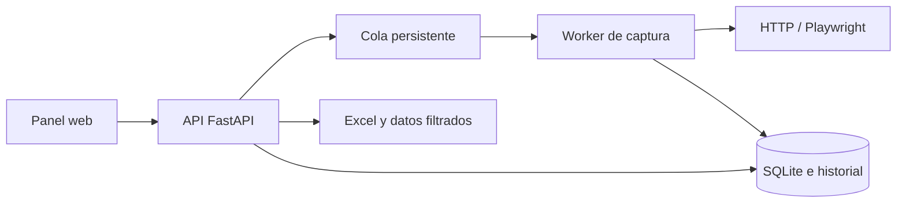

# MVD Inmuebles · Observatorio inmobiliario

Herramienta para recopilar avisos de apartamentos en Montevideo, conservar su historial de precios y explorarlos mediante una interfaz web con filtros y exportación a Excel.

**Python · FastAPI · Playwright · SQLite · Docker · JavaScript**

[Guía de despliegue](deploy/README.md) · [Manual completo y estado de las fuentes](docs/usage.md) · [Portfolio](https://felipeheredia.vercel.app)

## Qué permite hacer

- Lanzar capturas manuales y seguir su ejecución en segundo plano.
- Consultar alquileres y ventas por barrio, dormitorios, fuente y precio.
- Conservar observaciones e historial sin borrar datos ante un fallo de captura.
- Exportar resultados a Excel, JSON o CSV.
- Revisar candidatos a duplicados y el estado de cada fuente.



## Inicio con Docker

Requisitos: Python 3 para generar la configuración y Docker Compose.

```sh
git clone https://github.com/FelipeH99/Real-State-Scrapper.git
cd Real-State-Scrapper
python3 scripts/setup_deploy.py
docker compose up -d --build
```

Abrí **http://localhost:8000** e ingresá la clave local de `.secrets/api_key`. En **Capturas → Nueva captura**, seleccioná una fuente y un límite pequeño para el primer recorrido. La base empieza vacía; la captura requiere acceso a los portales.

API documentada en `http://localhost:8000/docs`. La [guía de despliegue](deploy/README.md) explica autenticación, variables, backups y operación.

## Estado y límites

MVP para un host y un worker. Las capturas son manuales y los portales pueden cambiar o bloquear el acceso. Mercado Libre sigue deshabilitado en el servicio; RE/MAX tiene paginación limitada. Consultá el [detalle por fuente](docs/usage.md#fuentes-y-estado-del-mvp) antes de ejecutar.

Los avisos no son precios de cierre ni una muestra estadística del mercado. Un aviso ausente no significa vendido o alquilado. Las posibles coincidencias entre portales se presentan como candidatos, no se fusionan automáticamente.

## Pruebas sin consultar portales

```sh
python3 -m venv .venv
.venv/bin/pip install -r requirements-service.lock
.venv/bin/python -m unittest discover -s tests -v
```

Usan datos sintéticos y bases temporales. Las pruebas opcionales con Chromium y el servidor de fixtures se explican en el [manual](docs/usage.md#desarrollo).

## Código para explorar

| Ruta | Responsabilidad |
| --- | --- |
| `estate/service/api.py` | Endpoints y sesiones |
| `estate/service/worker.py` | Ejecución de trabajos |
| `estate/service/queue.py` | Cola durable |
| `estate/service/web/` | Interfaz de consulta |
| `estate/collect.py` | Captura por fuente |
| `estate/storage.py` | Persistencia e historial |
| `tests/` | Casos del motor, servicio y web |

Se versionan código, configuración pública, pruebas y documentación. Bases, capturas, claves y resultados reales permanecen fuera del repositorio.
