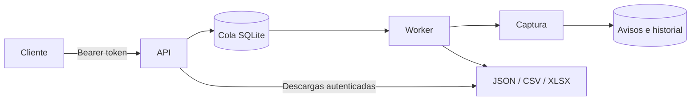

# Despliegue del servicio

La versión de servicio ejecuta el motor mediante una API FastAPI y un worker
separado. La cola, los avisos, las observaciones y las exportaciones persisten en
un volumen Docker. Las capturas se inician manualmente por API: no hay scheduler.



## Alcance operativo

- Arquitectura para **un host Linux**, disco local persistente, una API y un worker.
- SQLite en WAL con transacciones para reclamar trabajos; no requiere Redis ni
  PostgreSQL en esta escala. No usar NFS ni escalar workers/hosts con este volumen.
- El worker toma un bloqueo exclusivo. Después de un reinicio, marca los trabajos
  interrumpidos como fallidos; los que seguían en cola se conservan. No reintenta
  capturas automáticamente ni declara que un trabajo interrumpido terminó bien.
- Un job admite hasta 30 páginas solicitadas, 5.000 avisos y 100 fichas. Se respetan
  también los límites inferiores por fuente. Cola máxima: 50 trabajos activos.
- El plazo máximo predeterminado es una hora para las etapas de captura,
  enriquecimiento y exportación de datos; la escritura final XLSX es síncrona.
- Recomendada como base inicial: 2 CPU, 4 GB RAM y SSD con espacio para Chromium,
  capturas y exportaciones. Ajustar recursos al volumen real. Las capturas y los
  logs por trabajo no se purgan automáticamente; monitorear uso del disco.
- La API es de uso interno: token compartido, sin usuarios ni RBAC. No es todavía
  una aplicación SaaS multiusuario ni incluye una interfaz web propia.

Docker no elimina bloqueos de terceros. El worker usa Xvfb para las fuentes que
necesitan Chromium con ventana; no publica escritorio remoto. Casas y Más y
Campiglia son las primeras fuentes para probar en el servidor. RE/MAX sigue
limitado a una página y puede bloquear IPs de servidores. Mercado Libre no está
habilitado en la API; el inicio de sesión manual continúa como función local.

## Inicio en un servidor

Requisitos: Docker Engine con plugin Compose v2 y Python 3 para crear el secreto.
Desde la raíz del repositorio:

```sh
python3 scripts/setup_deploy.py
docker compose up -d --build
curl --fail http://127.0.0.1:8000/health/ready
```

El script genera un token aleatorio sin mostrarlo ni reemplazar uno existente.
`.secrets/` tiene permisos 0700; el archivo es legible dentro del contenedor no
root. La carpeta, el token y los datos quedan fuera de Git y del build context.
No copies perfiles de navegador personales al servidor.

La API se publica solo en `127.0.0.1:8000` por defecto. Su documentación interactiva
está en `/docs`; las operaciones de datos requieren **Authorize → Bearer token**.
La documentación pública y los health checks no contienen avisos ni secretos.

Para exponerla fuera del host, usar un reverse proxy con HTTPS y restricciones de
red. No cambiar `ESTATE_BIND` a `0.0.0.0` en Internet sin configurar ese perímetro.
El token es una credencial: no debe quedar en URLs, frontend público ni logs.
No se configura un dominio o proveedor cloud automáticamente.

## Crear y consultar una ejecución

Ejemplos con un cliente Python para evitar dejar el token literal en el historial:

```python
import json
import urllib.request
from pathlib import Path

base = 'http://127.0.0.1:8000'
token = Path('.secrets/api_key').read_text().strip()
headers = {'Authorization': f'Bearer {token}', 'Content-Type': 'application/json'}
body = {'sources': ['casasymas'], 'pages': 8, 'max_listings': 1000, 'details': 12}
request = urllib.request.Request(base + '/jobs', data=json.dumps(body).encode(),
                                 headers={**headers, 'Idempotency-Key': 'captura-manual-001'})
with urllib.request.urlopen(request) as response:
    job = json.load(response)
print(job['id'], job['state'])

request = urllib.request.Request(base + '/jobs/' + job['id'], headers=headers)
with urllib.request.urlopen(request) as response:
    print(json.load(response))
```

Usar una clave de idempotencia distinta para cada captura deliberadamente nueva.
Repetir una clave con el mismo cuerpo devuelve el mismo trabajo; cambiar el cuerpo
con la misma clave responde 409. Los campos desconocidos, fuentes no habilitadas y
límites inválidos se rechazan antes de encolar. No se admiten comandos, URLs ni
rutas arbitrarias desde la API.

Estados: `queued`, `running`, `completed`, `partial`, `failed`, `cancelled`.
`partial` significa que alguna fuente o ficha falló. Los archivos de una ejecución
completada o parcial incluyen toda la base, también avisos anteriores: revisar
fechas y `runs.json`. La exportación no equivale a resultados nuevos del job.

| Endpoint | Uso |
| --- | --- |
| `GET /health/live` | Proceso API vivo |
| `GET /health/ready` | Cola accesible y heartbeat reciente del worker |
| `GET /sources` | Fuentes y límites |
| `POST /jobs` | Encolar captura |
| `GET /jobs` | Últimos trabajos |
| `GET /jobs/{id}` | Estado de un trabajo |
| `POST /jobs/{id}/cancel` | Cancelar un trabajo todavía en cola |
| `GET /listings` | Filtrar avisos y paginar respuestas |
| `GET /jobs/{id}/files/{filename}` | Descargar un archivo permitido |

Filtros de `/listings`: `source`, `operation`, `neighborhood`, `bedrooms`,
`currency`, `max_price`, `limit`, `offset`. Precio máximo exige moneda.

Archivos: `properties.json`, `properties.csv`, `inmuebles-montevideo.xlsx`,
`coverage.json`, `duplicates.json`, `runs.json`, `changes.json`. El XLSX del servicio
usa XlsxWriter como dependencia de la aplicación; no necesita Node ni Codex.
Las cadenas de terceros se escriben como texto, nunca como fórmulas.

## Persistencia, logs y recuperación

El volumen `estate-data` se monta en `/var/lib/estate`:

- `estate.sqlite3`: avisos, observaciones y detalles.
- `jobs.sqlite3`: cola durable y estados de trabajos.
- `jobs/<id>/output/`: exportaciones por ejecución.
- `jobs/<id>/worker.log`: salida de las etapas del trabajo.
- `captures/` y `details/`: evidencia local de extracción.

```sh
docker compose ps
docker compose logs --tail=100 api worker
docker compose exec worker cat /var/lib/estate/jobs/ID/worker.log
```

Logs Docker rotan a 3 archivos de 10 MB. Los logs por job y las capturas se
conservan para diagnóstico. La API no permite descargar logs, cookies o HTML.

Para respaldar SQLite usando su API de backup, sin copiar archivos WAL abiertos:

```sh
docker compose stop worker
docker compose run --rm --no-deps worker python -m estate.service.maintenance
docker compose start worker
```

El respaldo queda en `/var/lib/estate/backups/<fecha>/`. Copiar esa carpeta y las
exportaciones necesarias a almacenamiento externo; un backup en el mismo volumen
no protege de pérdida del disco. Guardar el token por separado. Para restaurar,
detener ambos servicios, respaldar el estado actual y restaurar ambas bases desde
el mismo respaldo; no mezclar bases con sus viejos archivos `-wal`/`-shm`.

`docker compose down` conserva el volumen. **`down -v` elimina los datos** y solo
se usa en las pruebas descartables de CI. No ejecutar durante actualizaciones.

## Build, CI y release

`requirements-service.lock` fija las dependencias transitivas probadas.
`requirements-service.in` documenta los inputs. El Dockerfile instala Chromium
con la misma versión de Playwright que el lock y corre con UID 10001, filesystem
raíz de solo lectura, capacidades eliminadas y límites de memoria/CPU.

La pipeline de GitHub Actions realiza:

1. Instalación del lock, `pip check`, pruebas unitarias e integración Chromium local.
2. Build Docker y smoke test: fuente sintética → API → worker → SQLite → JSON/CSV/XLSX.
3. Publicación opcional en GHCR para tags `v*` o ejecución manual con `publish=true`.
   Produce imágenes amd64/arm64, tags de commit, SBOM y provenance.

Los pushes a `main` validan; **no despliegan en un servidor**. La publicación de
una imagen requiere permisos de Packages de GitHub y la ejecución exitosa de CI.
Para usar una imagen publicada, copiar `.env.example` a `.env`, configurar
`ESTATE_IMAGE` con un tag inmutable o digest, y ejecutar:

```sh
docker compose pull
docker compose up -d --no-build
```

Conservar el tag anterior para rollback. Esta versión agrega tablas de forma
compatible; futuros cambios de esquema requieren migraciones y un plan de rollback.

## Validación local de Docker sin consultar portales

```sh
python3 scripts/setup_deploy.py
docker build -t real-estate:local .
docker compose -p estate-smoke -f compose.yaml -f compose.smoke.yaml up -d --no-build
python3 scripts/smoke_deploy.py
docker compose -p estate-smoke -f compose.yaml -f compose.smoke.yaml down -v
```

Este proyecto Compose usa un volumen distinto. No combinar el override de prueba
con un volumen de producción: contiene anuncios sintéticos. El test de Docker
prueba el despliegue, no la disponibilidad de cada portal desde un proveedor cloud.

Referencias de implementación: [Docker con Playwright](https://playwright.dev/python/docs/docker)
y [FastAPI en contenedores](https://fastapi.tiangolo.com/deployment/docker/).

## Aplicación web

La raíz `/` sirve el explorador y el panel de capturas. Después de ejecutar
`docker compose up -d --build`, abrí `http://localhost:8000` y usá la clave local
`.secrets/api_key`. Las actualizaciones conservan el volumen de propiedades.
La web inicia capturas únicamente al pulsar **Iniciar captura**.

API adicional (también acepta el Bearer existente):

- `POST /session` con `{"token":"CLAVE"}` crea la cookie HttpOnly por ocho horas.
- `GET /session` verifica la sesión; `DELETE /session` elimina la cookie local.
- `GET /listings/meta` devuelve barrios disponibles y totales de la base.
- `GET /listings/export` genera Excel con todos los resultados filtrados.
- `/listings` y `/listings/export` aceptan `source`, `operation`, `neighborhood`,
  `bedrooms`, `currency`, `min_price`, `max_price` y `sort` (`recent`, `price_asc`,
  `price_desc`). Filtrar u ordenar por precio exige moneda; no se convierten divisas.

Las mutaciones autenticadas con cookie exigen `X-Requested-With: EstateWeb` y
origen coincidente. La cookie usa Secure cuando la petición llega como HTTPS.
En un proxy TLS, configurá Uvicorn para confiar solamente en la IP de ese proxy
(`FORWARDED_ALLOW_IPS`), y reenviá Host y X-Forwarded-Proto correctamente. El puerto
8000 debe quedar accesible solamente para el proxy. Rotar la clave invalida todas
las sesiones. Cerrar sesión borra la cookie del navegador; no revoca otras sesiones.

Pruebas de interfaz: `PLAYWRIGHT_TESTS=1 .venv/bin/python -m unittest discover -s tests -v`.
El navegador usa una base temporal y comprueba filtros, paginación, descarga Excel,
creación y cancelación de capturas, persistencia de sesión y vista móvil.
